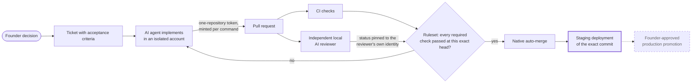

# Governed AI-assisted engineering

Last verified: 2026-11-07

I'm Manish Kumar.
I've spent about twenty years in engineering, cloud infrastructure, SRE, security and technical leadership.
Since August 2026 I have been building the engineering platform my own products are developed on, and this repository explains how it works.

The short version: an AI coding agent implements ticketed work under its own restricted operating-system identity, a separate local AI reviewer independently reviews the exact commit it produced, a deterministic controller decides whether that review is good enough, and GitHub enforces the result.
Nothing merges because an agent says it is finished.

The platform itself lives in a private repository.
This showcase describes its architecture, the decisions behind it, the mistakes that shaped it and the evidence for what it does today, without publishing the operational details that keep it safe.
Every capability carries a status, and only what is marked **Implemented** runs in full today.

## How work moves through the system

Solid boxes are operating today.
The thick border marks staging, which is partially implemented, and the dashed box is planned.
The [operating model](docs/operating-model.md) walks through each step and who holds authority at it.

## What I built

| Area | What it does | Status |
| --- | --- | --- |
| [Isolated engineering agent](docs/architecture/isolated-agent.md) | The coding agent runs as a separate non-admin macOS account that cannot read the founder's credentials and has no GitHub identity of its own. A negative test proves it from inside the account. | Implemented |
| [Brokered GitHub authorization](docs/architecture/github-authorization.md) | The agent gets a GitHub App token for exactly one repository and one permission profile per command, from a broker that holds the only key. The token is revoked when the command ends, and every failure is a refusal. | Implemented |
| [Independent local AI reviewer](docs/architecture/independent-reviewer.md) | A daemon under its own identity reviews every pull request at its exact head and base on a local model, with no shell and no ability to execute pull-request code. The model proposes findings, deterministic code decides the verdict, and the published status is pinned to the reviewer's identity so nothing else can satisfy it. | Implemented |
| [Governance as versioned components](docs/workflows/delivery-lifecycle.md#shared-governance-components) | Ticket and pull-request policy, runner policy and a product repository standard are released as immutable versions that every repository pins by commit SHA, with an onboarding operation that audits the whole organization against its declared state. | Implemented |
| [Delivery lifecycle](docs/workflows/delivery-lifecycle.md) | Exact-commit staging deployment with a served-identity check is built and tested. Artifact promotion, founder-bound production approval and rehearsed rollback are designed and not built. | Partially implemented |

## The evidence, including the uncomfortable parts

A point-in-time audit of the reviewer on 2026-11-01 found that 9 of its 18 blocking findings that month were false positives.
It also found that every one of its real findings was something no test or CI check had caught, including a database permission change that would have broken a dashboard for every user because the tests mocked the database.
The final review of a pull request took a median of 7.7 minutes to run.
The long waits came from queueing behind other reviews, which reached 89.5 minutes at the 95th percentile.

Those numbers, their method and their limits are in the [evidence index](docs/evidence/README.md).
I have not measured deployment frequency, engineering effort saved or the reviewer's recall, and the showcase does not claim them.

For scale: the platform repository has 386 commits, 136 merged pull requests and 205 tickets between 2026-08-13 and 2026-11-07.

## A fifteen-minute reading path

1. [Operating model](docs/operating-model.md): the whole flow and the design philosophy behind it.
2. [Independent local AI reviewer](docs/architecture/independent-reviewer.md): the deepest technical piece.
3. [Engineering decisions](docs/decisions/README.md): six decisions, including two I reversed.
4. [Lessons](docs/lessons/README.md): failures the system found in itself and what changed.
5. [Evidence and status](docs/evidence/README.md) and the [roadmap](docs/roadmap.md): what is proven, what is not, and what comes next.

The [security and disclosure page](docs/security.md) explains what this repository deliberately leaves out and why.

## Status labels

| Label | Meaning |
| --- | --- |
| Implemented | Built, tested and running in daily use on the date shown. |
| Partially implemented | Some of it runs; the page says exactly which part. |
| Experimental | Built and used, without measured evidence that it works well enough to depend on. |
| Planned | Designed, not built. Never described as a capability. |
| Superseded | Built or adopted, then deliberately replaced. Kept because the reason matters. |

## About me

- GitHub: [manishkumarglobal](https://github.com/manishkumarglobal)
- LinkedIn: [manishkumarglobal](https://www.linkedin.com/in/manishkumarglobal/)
- YouTube: [@manishkumarglobal](https://www.youtube.com/@manishkumarglobal)
- Instagram: [manishkumarglobal](https://www.instagram.com/manishkumarglobal/)

## License

Documentation and diagrams are licensed under [CC BY 4.0](LICENSE).
The example code under [`examples/`](examples/README.md) is licensed under the [MIT License](LICENSE-CODE).
Every example is a standalone illustration written for this repository; none is copied from the private platform.
