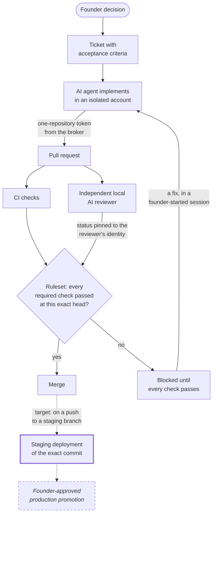

# Governed AI-assisted engineering

Last verified: 2026-11-08

This repository describes a private engineering platform that lets an AI coding agent do real implementation work on my products while holding as little authority as possible.
I built it because an agent that runs as its developer's own account can use every credential that account holds, and an agent that checks its own work is not an independent check.
Today the platform runs the agent under its own restricted operating-system account, gives it a GitHub token for one repository at a time, has a separate local AI reviewer judge the exact commit it produced, and lets GitHub merge only when every required check passed at that commit.
To explore, start with the [operating model](docs/operating-model.md), then the [evidence and status page](docs/evidence/README.md) for what is proven and what is not.

I'm Manish Kumar, the founder of MK Global; where these pages say "the founder", they mean me.
I've spent about twenty years in engineering, cloud infrastructure, SRE, security and technical leadership, and since August 2026 I have been building this platform, which my own products are developed on.
Its source is private, so this repository explains its architecture, the decisions behind it, the mistakes that shaped it and the evidence for what it does today, without publishing the operational details that keep it safe.

## The problem

AI coding agents write code quickly; the harder engineering question is what authority they hold while they do.
An agent is usually run as the developer's own user, so it can read their SSH keys, their GitHub CLI login and every other credential that user can read, and no GitHub setting can tell its actions apart from the developer's.
If the same agent reviews its own change, the context that made a mistake is the context checking for it.
And a control that exists only as a habit, such as reading every diff before merging, stops existing the first time merging is automated.
The platform's answer is to give each actor its own identity with an explicit, enforced list of what it may do, and to let deterministic checks, not an agent's claim, decide when work is done.
Nothing merges because an agent says it is finished.

## What runs today

Every capability carries a [status label](#status-labels), and only what is marked Implemented runs in full today.

- **Implemented: [isolated engineering agent](docs/architecture/isolated-agent.md).**
  The coding agent runs as a separate, non-admin macOS account that cannot read the founder's credentials and has no GitHub identity of its own.
  A negative test run from inside the account checks this.
- **Implemented: [brokered GitHub authorization](docs/architecture/github-authorization.md).**
  For each command, the agent gets a GitHub App token for exactly one repository and one permission profile, from a broker that holds the only key, and any failure to obtain a token is a refusal.
  The token is normally revoked when the command ends; GitHub's one-hour expiry is the hard bound.
- **Implemented: [independent local AI reviewer](docs/architecture/independent-reviewer.md).**
  A daemon under its own identity reviews pull requests in the repositories it is authorized for, at their exact head and base, on a local model, with no shell and no way to run pull-request code.
  The model proposes findings, deterministic code decides the verdict, and the required status is pinned to the reviewer's identity, so no other identity's status can satisfy it.
  Its independence has one recorded, accepted residual dependency, on its local model server, described in its [limitations](docs/architecture/independent-reviewer.md#limitations).
- **Implemented: [governance as versioned components](docs/workflows/delivery-lifecycle.md#shared-governance-components).**
  Ticket and pull-request policy, runner policy and a product repository standard are released as tagged versions, which by policy are never moved, and the governed private repositories pin them by full commit SHA; public repositories follow a separate model.
  An onboarding operation audits the organization against its declared state and, since 2026-11-08, fails a repository whose default branch does not carry the released versions.
- **Built, not in service: [staging delivery](docs/workflows/delivery-lifecycle.md#staging).**
  A staging adapter that deploys an exact commit, waits until it is served, and checks that the served build talks to the staging backend is built and tested.
  No product deploys through it yet.
- **Planned: [production promotion](docs/workflows/delivery-lifecycle.md#production-promotion-and-rollback).**
  Artifact promotion, founder approval bound to one release candidate, and rehearsed rollback are designed and not built.

## How work moves through the system

Solid boxes and arrows run today; the thick border marks staging, which is built and tested but not in service; the dashed, italic box is planned; dotted arrows lead to work that does not run yet.
The [operating model](docs/operating-model.md) walks through each step and who holds authority at it.

## What this system does not do yet

- **It does not deliver to production.**
  Nothing promotes a release to production under this model.
  Products under the platform standard do not deploy to production on merge; one older product deploys from its default branch under a recorded founder exception.
- **It does not deploy staging.**
  The staging adapter is built and tested, but the workflow products would call is not released, so no product deploys through it.
- **The reviewer does not run the code it reviews.**
  Build, test and runtime evidence do not inform its verdict, and half of its blocking findings in the audited month were wrong.
- **The broker does not separate one agent session from another.**
  Any engineering session can request a token for any repository the agent may work on.
- **Self-hosted CI runners are not a boundary against hostile code.**
  They persist between jobs, which is why public repositories never use them.
- **One machine runs the agent, the reviewer, the model and the private runners.**
  Review stops when it sleeps.
- **The agent cannot do container-based work.**
  The isolated execution worker that would allow it is planned.
- **Not every governed repository has the standard branch rules yet.**
  Which rules differ is recorded on the [evidence page](docs/evidence/README.md).
- **The latest live isolation proof used an older copy of the checker.**
  The [evidence page](docs/evidence/README.md) records it, and a re-run with the current checker is pending a step the founder runs.

The [roadmap](docs/roadmap.md) orders the planned work.

## The evidence, including the uncomfortable parts

A point-in-time audit of the reviewer on 2026-11-01 found that 9 of its 18 blocking findings that month were false positives.
It also found that none of its 9 real findings had been caught by a test or CI check, including a database permission change that would have broken a dashboard for every user because the tests mocked the database.
For the two material findings, that was inferred by reading the tests at the reviewed head, because their CI results were not observable.

Across the 30 most recently merged pull requests in that audit, the final review of a pull request took a median of 7.7 minutes to run.
The long waits came from queueing behind other reviews: a median of about 3.4 minutes and about 92 minutes at the 95th percentile.
The [evidence page](docs/evidence/README.md#reviewer-audit-2026-11-01) gives the method and the limits.

I have not measured deployment frequency, engineering effort saved or the reviewer's recall, and the showcase does not claim them.

For scale: this is a single-owner platform on one Mac, and its reviewer is configured for ten private and public repositories.
As of the morning of 2026-11-07, the platform repository had 386 commits, 136 merged pull requests and 205 tickets since 2026-08-13.

## Reading path

The pages below, with the six decision records, total about 13,000 words, roughly an hour.
For a ten-minute version, read this page and the operating model.

1. [Operating model](docs/operating-model.md): the whole flow and the design philosophy behind it.
2. [Independent local AI reviewer](docs/architecture/independent-reviewer.md): the deepest technical piece.
3. [Engineering decisions](docs/decisions/README.md): six decisions, including two I reversed, such as removing a founder-approval rule a few days after I built it.
4. [Lessons](docs/lessons/README.md): failures the system found in itself and what changed.
5. [Evidence and status](docs/evidence/README.md) and the [roadmap](docs/roadmap.md): what is proven, what is not, and what comes next.

The [security and disclosure page](docs/security.md) explains what this repository deliberately leaves out and why.

## Status labels

| Label | Meaning |
| --- | --- |
| Implemented | Built, tested and running in daily use on the date shown. |
| Partially implemented | Some of it runs; the page says exactly which part. |
| Built, not in service | Built and tested, and not yet used by any product. |
| Experimental | Built and used, without measured evidence that it works well enough to depend on. |
| Planned | Designed, not built. Never described as a capability. |
| Superseded | Built or adopted, then deliberately replaced. Kept because the reason matters. |

## About me

- GitHub: [manishkumarglobal](https://github.com/manishkumarglobal)
- LinkedIn: [manishkumarglobal](https://www.linkedin.com/in/manishkumarglobal/)
- YouTube: [@manishkumarglobal](https://www.youtube.com/@manishkumarglobal)
- Instagram: [manishkumarglobal](https://www.instagram.com/manishkumarglobal/)

## License

Documentation and diagrams are licensed under [CC BY 4.0](LICENSE).
The example code under [`examples/`](examples/README.md) is licensed under the [MIT License](LICENSE-CODE).
Every example is a standalone illustration written for this repository; none is copied from the private platform.
