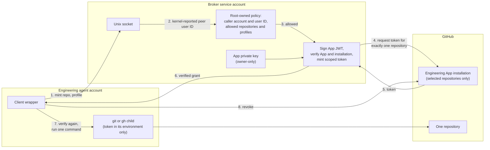

# GitHub authorization and the key broker

Last verified: 2026-11-07

Status: **Implemented.**
Per-command tokens since 2026-10-06; the key broker has held the only App key since 2026-10-13.

The engineering agent reaches GitHub through one path: a GitHub App installation token for exactly one repository and one permission profile, minted for a single command and revoked when that command ends.
The App's private key lives with a separate service account, the key broker, which the agent can ask for a token but can never read.

## Why a GitHub App, and why not a token on disk

The starting point was an audit of how automation authenticated to GitHub.
It found the founder's own credentials in reach of agent sessions, and a machine-user fine-grained personal access token used for agent work.

A machine user with a long-lived token has three problems.
The token is a bearer credential that lasts as long as nobody rotates it.
Its permissions are set once and are usually broader than any single operation needs.
And it is a second human-shaped account in the organization, with its own login, which is one more thing to protect.

A GitHub App fixes the first two by design.
Its installation tokens expire within an hour, and each one can be narrowed at minting time to specific repositories and a subset of the App's permissions.
The App has no password, no SSH key and no web login.

## The permission ceiling

The Engineering App was created with a fixed permission set that changes only through a recorded decision backed by an observed need:

| Permission | Access | Why |
| --- | --- | --- |
| Contents | Read and write | Fetch and push branches |
| Pull requests | Read and write | Open and update pull requests |
| Issues | Read and write | Maintain tickets |
| Checks, commit statuses | Read | See CI and review results |
| Metadata | Read | Required by GitHub |
| Workflows, Actions, administration, deployments, environments, secrets, variables, organization permissions | None | The agent must not be able to change CI, rulesets, deployment or credentials |

It subscribes to no webhook events and is installed only on selected repositories.
Because it holds no Workflows permission, GitHub itself refuses its attempts to create or change workflow files, so CI definitions can only be changed by a human-run step.

## One command, one repository, one token

The client wrapper the agent uses does the following for every `git` or `gh` operation, and refuses before any child process runs if any step fails:

1. **Work out the repository.** The checkout's `origin` is normalized to `owner/repo` and must be on an allowlist installed root-owned, where the agent cannot edit it. A second GitHub remote, or repository Git configuration that rewrites URLs, sets credential helpers, adds headers or proxies, or swaps the SSH command, is refused.
2. **Refuse ambient credentials.** Any GitHub token variable, askpass helper, Git configuration override or token-shaped value in the environment is a refusal.
3. **Get a token from the broker** for that repository and either the `read` or the `write` profile.
4. **Verify the token independently.** It must be an installation token of the expected shape, expire within the hour, be limited to selected repositories, list exactly the one requested repository, and carry exactly the requested permissions: nothing extra, nothing higher, nothing missing.
5. **Run one child process** with an environment built from nothing. Git gets an ephemeral askpass helper and has its credential helpers, user configuration and system configuration disabled for that invocation; the GitHub CLI gets an empty, throwaway configuration directory. Commands outside a small set (`pr`, `issue`, `api`, `repo`, `label`) and arguments that name another repository are refused.
6. **Revoke the token immediately**, whether the command succeeded or failed, so its useful life is one command rather than GitHub's hour.

There is no command that prints a token.

## The key broker

Anyone holding an App's private key can sign App JWTs and mint tokens for every repository the App is installed on, with every permission the App has, whatever the client wrapper would have asked for.
While the key sat in the agent's own account, any process running as the agent could do exactly that.

The broker moves the key to a separate service account the agent cannot reach.
That account is hidden, has no shell, no admin rights and no home of its own, and it runs a small daemon whose code, policy and allowlist are installed root-owned and read-only.



The broker identifies its caller from the operating system's peer credentials on the socket, never from anything the caller sends.
The client, in turn, checks that the socket and its directory belong to the broker and that the peer on the other end is the broker's account, so a process that managed to bind a look-alike socket cannot hand the client a token of its choosing.

### The protocol

One connection carries one request line and one response line.
This is an illustrative exchange with a synthetic repository:

```json
{"v":1,"op":"mint","repository":"example-org/example-repo","profile":"read"}
{"v":1,"ok":true,"grant":{"token":"<redacted>","expires_at":"<timestamp>","repository_selection":"selected","repositories":[{"full_name":"example-org/example-repo"}],"permissions":{"contents":"read","metadata":"read"}}}
```

Requests are size-limited and time-limited, and anything with an unknown operation, an extra field, a malformed repository name or an unknown profile is refused.
There is no operation that returns a key, a JWT, or a token outside a mint grant.

### Failure is refusal

| Condition | Result |
| --- | --- |
| Caller not in the policy | Refused before its request is read |
| Repository or profile not granted | Refused, no GitHub call |
| Too many requests in flight, or too many per minute | Refused immediately, no queue |
| GitHub slow, unreachable, or answering with the wrong App, installation or token | Refused; every GitHub call is time-bounded |
| A grant that cannot be delivered | Revoked at once |
| Broker down, socket missing, wrong owner, wrong peer | The client refuses. There is no fallback to a key on disk, a personal token, or the founder's credentials. |

While the broker is down, the agent has no GitHub access at all.
That is the design working, not an outage of some other control.

### What the broker protects, and what it does not

| | Key in the agent's account | Key in the broker |
| --- | --- | --- |
| Who can read the App private key | the agent | only the broker (and root) |
| Agent signs its own App JWT | possible | impossible |
| Agent mints a token outside the wrapper's rules, such as several repositories at once or a broader permission | possible | impossible |
| Agent gets a one-repository token for any repository it is authorized for | possible | **still possible** |
| A token, once handed over, is a bearer credential until revoked | yes | yes |

The broker authorizes callers by operating-system user, and every engineering session runs as the same user.
So the broker cannot tell a session working on one product from a session working on another, and any session can ask for a token for any repository the agent is allowed to work on.
The repository a client names is a request, never an identity.

The broker protects the key.
It does not give per-session repository isolation, and the platform does not claim it does.
Closing that gap would need a session identity the broker can verify independently of the caller, such as a separate operating-system account or execution boundary per repository, and the current architecture deliberately does not add per-product accounts yet.

## Adding a repository

Three things must agree before a repository works: the App installation's repository selection on GitHub, the broker's policy, and the client's installed allowlist.
The broker reads its policy only when it starts, and the client's live self-check compares its allowlist with the installation's selection as an exact set, so the change is applied in one short, ordered window: merge the change, select the repository on the installation, install and restart the broker, install the client, then verify.
Verification includes proving that a token for the new repository cannot read the existing ones and that their tokens cannot read it.

Each repository is a separate founder decision recorded on a ticket.
The allowlist currently names five repositories, and the client's live self-check fails whenever the allowlist and the installation's selection are not the same set.

## Tests

The client and the broker are tested against an in-process fake GitHub that independently verifies every JWT's signature and claims, with test keys generated at run time so no key is ever committed.
The broker tests run on a real Unix socket with real kernel peer credentials.
They cover caller authorization, scoping, a wrong grant handed over by an impostor at the socket, malformed and hostile requests, size and time limits, leakage of tokens, JWTs and keys into output, logs, responses and files, GitHub failures, broker unavailability without fallback, concurrency limits, rate limits, revocation in every path, and draining in-flight requests on shutdown.

## Related

- [Isolated engineering agent](isolated-agent.md)
- [Decision 2: brokered, short-lived credentials](../decisions/02-brokered-short-lived-credentials.md)
