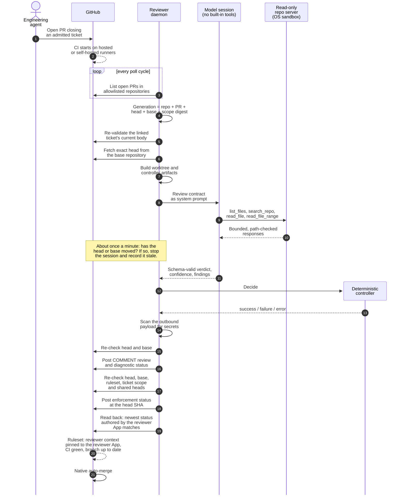
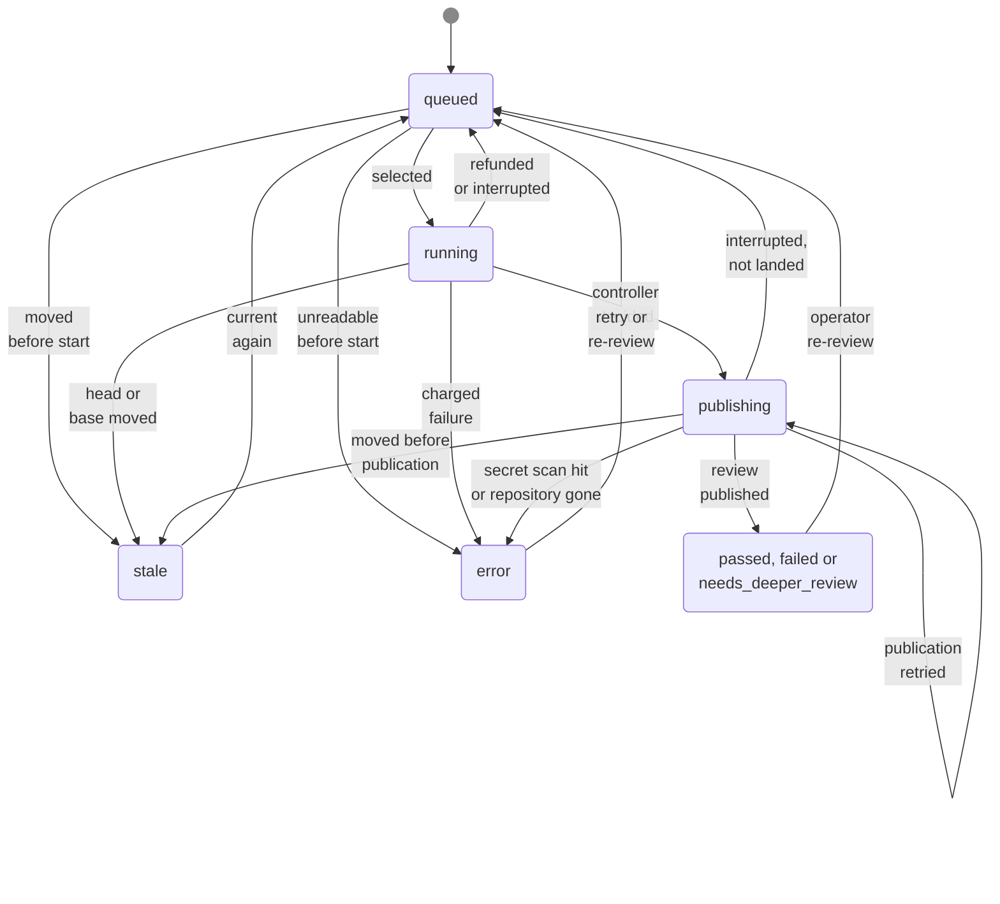

# Independent local AI reviewer

Last verified: 2026-11-08

Status: **Implemented.**
First built on 2026-08-13 and now the required review gate on the protected branches of the platform repository, several private product repositories and two public repositories: CreatorBrio and this showcase.
Since 2026-10-29 it runs as a dedicated system service.

The reviewer is a long-running daemon that reviews pull requests with a local model, publishes a commit status that branch rules require before merging, and is built so that the identity that wrote a change cannot publish or satisfy that status itself.
It reads and reasons about code; it never builds, installs, tests or executes anything from a pull request.

## Why an agent reviewing its own change is not review

The engineering agent can, and does, check its own work.
That is useful, and it is not independent.
The same context, prompt history and assumptions that produced a mistake are the ones looking for it, and the agent controls what it shows itself.
An agent that can also publish the "review passed" signal can simply publish it.

Independence here means four concrete things:

- **A different process with a different context.** The reviewer starts from the pull request on GitHub, not from the implementing session.
- **A different identity.** It runs under its own GitHub App and its own macOS service account. The engineering identity cannot read its key, write its installation, or post a status the branch rules will accept.
- **Inputs the author cannot shape.** The verdict is computed from the exact head and base commits and, where tickets are required, the ticket's scope. Pull-request titles and descriptions are not inputs to the enforced result, because the author can edit them after a pass.
- **A decision the model does not make alone.** The model proposes findings; deterministic code decides the gate.

## Architecture

```text
GitHub App installations
  -> repository allowlist (the only authorization; visibility is not permission)
  -> open pull requests
  -> generation identity: repository + PR + head SHA + base SHA + ticket-scope digest
  -> already settled? skip
  -> bare mirror + disposable worktree, Git hardened
  -> controller-generated review artifacts
  -> Claude Code, headless, with every built-in tool removed
  -> read-only repository-access server inside an OS sandbox
  -> schema-validated result
  -> deterministic verdict policy
  -> secret scan -> staleness check -> duplicate-publication check
  -> review comment + diagnostic status
  -> ruleset, ticket-scope and shared-head checks
  -> enforcement status, read back
  -> SQLite state, worktree removed
```

Inference runs on a local model server with an Anthropic-compatible API, on the same machine.
Claude Code is the agent runtime that drives the review session against that local endpoint.
The sealed release's configuration points the endpoint at a loopback address, so as configured no pull-request content leaves the machine for inference.

## From pull request to merge



Every step shown runs today.
The diagram follows a review that passes; [when things go wrong](#when-things-go-wrong) covers the other outcomes.

## Discovering and scheduling work

**Authorization is an allowlist.**
The reviewer's GitHub App is publicly installable, so anyone on GitHub can make their repositories visible to it.
Visibility is therefore never permission.
Exactly one list of exact, case-sensitive `owner/repo` names authorizes review work, everything else is discarded before its pull requests are even listed, and an empty list refuses to start rather than meaning "everything".

**Every review has an identity.**
A review is keyed by repository, pull request, head SHA, base SHA and a digest of the ticket scope, plus the version of the review-marker format, enforced by a unique constraint in its database.
The base is part of the identity because a review describes a diff, and the diff changes when the base moves even if the head does not.
The scope digest is part of it because a ticket edited after a pass changes what work was authorized.
Polling the same pull request every minute creates no duplicate work.

**One review runs at a time.**
That is a measured limit: two concurrent reviews on 2026-09-07 raced on the shared per-repository Git mirror, and concurrency stays at one until that is fixed.
With one slot, queue order decides how long a pull request stays unmergeable, so selection is deterministic and logged:

1. Reviews into a protected branch run before advisory reviews of other branches.
2. Higher declared project priority first.
3. Human or agent pull requests before bot pull requests, within a priority tier.
4. A pull request that has already been reviewed once and had a fix pushed runs before one nobody has looked at yet.
5. Oldest first, by the first time any version of the pull request was queued.

Two bounded starvation guards stop a busy high-priority project, or a stream of follow-up fixes, from starving everything else.
Retries after an infrastructure failure deliberately do not earn priority, or the queue would reward failure.
Every selection writes one log line saying why that pull request was chosen.

## Reviewing the exact commits

The head is fetched from the base repository's `refs/pull/<n>/head`, so a fork is never contacted, and the fetched commit must equal the SHA the API reported.
Git runs with user and system configuration disabled, hooks disabled, LFS and filters cleared, submodules never recursed and symlinks materialized as plain files, so nothing in a pull request runs during checkout.
Credentials reach Git only through an ephemeral askpass helper, never in arguments or in `.git/config`.

The diff comes from GitHub when GitHub will render it.
GitHub refuses to render diffs above 20,000 lines, so for exactly that refusal the reviewer computes the comparison locally.
It takes the merge base from GitHub's compare endpoint rather than from its own shallow mirror, because a shallow repository does not reliably refuse ancestry questions: when its boundary hides history it can answer them wrongly, and the wrong answers look exactly like real ones.
It then checks the local result against GitHub's own file, addition and deletion counts and fails the run on any mismatch, because an incomplete diff is indistinguishable from a smaller, cleaner change.
A diff is never truncated to fit; it is split into parts the model reads in order, and a diff too large even for that fails the review.

## Containment

The reviewer reads attacker-controlled content and publishes to pull requests, so containment is the central design concern.

**No built-in tools.**
Claude Code is launched with every built-in tool removed: no shell, no file read or write, no web access, no sub-agents.
Repository access comes only from a controller-owned server exposing four read-only tools: list files, literal search, read a file, read a line range.
Before trusting the session, the controller reads the session's initialization event and aborts unless the registered tool set is exactly those four and the server is connected.
That check exists because the CLI can silently drop a tool setting it does not accept, and does not report refused tool calls, so a misconfigured session would otherwise fail open.

**Layers, each enforced in code and covered by tests:**

1. **Capability boundary.** Every path is canonicalized, symlinks resolved, kept inside its root, and must appear in an inventory built from `git ls-files`. Binary files, oversized reads, unbounded searches and long line ranges are refused.
2. **Literal search.** No regular expression is ever compiled from model input.
3. **OS sandbox.** The repository server runs under macOS `sandbox-exec` with no network, no file reads anywhere under the user home directories, the system configuration directory or the root account's home, and no writes under the user home directories, apart from read access to the worktree, the review artifacts and its own code. Other system files and file metadata stay readable. Each start verifies the denial against the reviewer's real private key.
4. **Secret separation.** Child processes get an environment built from an explicit allowlist. The App key and tokens never reach the model or the repository server.
5. **Publication guard.** The exact outbound payload is scanned for credential shapes and for the live token and key by value and fingerprint, before it is stored and before it is sent. A hit publishes nothing.
6. **Output neutralization.** Mentions and leading slash commands in model text are defused, so a prompt-injected review cannot notify people or command other bots.

Two layers are also checked at run time. The daemon refuses to start unless the OS sandbox proves its denials on this machine, and each review session is aborted unless it registered exactly the expected tool set. The other layers are not re-checked at startup.

**Three trust roots.**
The model sees files under `run/` (controller provenance: identifiers, validated SHAs and booleans only), `pr/` (the diff, the changed-file list, the file inventory and, where tickets are required, the ticket's scope contract, all untrusted; titles and descriptions are deliberately left out) and `repo/` (the worktree, untrusted).
Artifacts live outside the worktree, so a pull request cannot ship its own provenance file.
The review contract arrives only as the system prompt and is not readable through any tool, so repository content cannot replace it.

## Structured findings, and who decides

The model must return a result that validates against a schema: a verdict of `PASS`, `CHANGES_REQUIRED` or `NEEDS_DEEPER_REVIEW`, an overall confidence, a summary, the files it inspected, and findings with severity (`P1` to `P3`, or `INFO`), title, file, line, evidence, impact, recommendation and confidence.
An illustrative schema is in [`examples/review-result.schema.json`](../../examples/review-result.schema.json).

The controller then decides, deterministically:

| Condition | Gate |
| --- | --- |
| Any P1 or P2 finding | failure |
| Model verdict `CHANGES_REQUIRED` | failure |
| Model verdict `NEEDS_DEEPER_REVIEW` | failure, described as inconclusive |
| Confidence below 0.80 | failure, described as inconclusive |
| `PASS`, no P1 or P2, confidence at or above 0.80 | success |
| Malformed output, budget exhausted, timeout, unreadable evidence, model unavailable | error |

P3 and INFO findings never block on their own.
A standalone version of this policy, with tests, is in [`examples/verdict-policy/`](../../examples/verdict-policy/).

The model also has a bounded budget of turns and wall-clock time, divided into exploration, verification and synthesis phases that the repository server enforces in-band.
A run that ends without a valid result is an error, never a pass.
The controller changes a model verdict in one bounded case: when it has verified from Git that a pull request is an exact rollback, it lowers findings in files the rollback restored byte-identical to P3, and if those were the only blocking findings, the model's `CHANGES_REQUIRED` becomes `PASS`, with a note on the review saying so.
A promotion pull request, which carries already-reviewed changes to another protected branch, is decided from the earlier authoritative reviews without a model run when they cover every change or one of them already failed.

## Publishing and merge gating

Two statuses go to the head commit:

| Context | Purpose |
| --- | --- |
| `local-ai/pr-review/<branch>` | Enforcement. One per protected branch, required by the branch's ruleset. |
| `local-ai/pr-review/pr-<number>` | Visibility for people. Never required. |

The review itself is posted as a `COMMENT`.
The reviewer never approves and never merges.

Three GitHub facts shape this, and each was learned by testing against real merges:

- **A commit status is not access-controlled per context.** Anyone with status-write permission can post `success` under any context name. A required check that is not pinned to a source matches on name alone, so the required context is pinned to the reviewer App's integration ID, here in a repository ruleset. A live test recorded with the code found that a `success` posted by another identity under the exact context, over the reviewer's `failure`, did not satisfy the requirement.
- **A status has no pull-request association.** Two pull requests can share a head commit against different bases, and a single shared context would let a review of one diff satisfy the other. This was demonstrated: a pass on a five-file diff satisfied a different pull request whose one-file diff had never been reviewed, and it merged. Hence one context per protected branch, which configuration validation enforces. On a branch that requires tickets, the reviewer also publishes no gate when another open pull request against the same protected branch shares the head under a different or unresolvable ticket scope.
- **The status says nothing about the base it was reviewed against.** Strict "branch must be up to date" freshness is what binds the two, so it is part of the security model. Before every authoritative publication the reviewer reads the ruleset back from GitHub and publishes no pass unless the context is required, pinned to it, and strict.

After publishing, the reviewer reads the commit's statuses back and checks that the newest one authored by its own App matches what it wrote.
It deliberately ignores other identities' writes rather than reacting to them, because reacting would hand any collaborator a way to deny every merge.

## When things go wrong

| Situation | Behavior |
| --- | --- |
| The head or base moves during a review | Checked about once a minute while the model runs. The session is stopped, the run is recorded stale with no verdict, and the new version is queued. Re-checked again immediately before publishing. |
| The ticket is edited after a pass | Any published success for the old scope is driven back to `pending` on the same head before a replacement review starts. |
| The ticket validator cannot run, or GitHub cannot be read for the ticket | Treated as not admitted: any published success is withdrawn and nothing new is published. |
| The model server refuses work before the model produces anything | The attempt is refunded and deferred with backoff, at most eight times in a row. Probes use a real one-token request, because health endpoints stayed green during an actual outage. |
| Timeout, malformed output, transport interruption after the model began | Charged as a failed attempt. Repeated attempts are capped, because a nondeterministic model asked often enough will eventually pass anything. |
| Publication to GitHub fails after a verdict is decided | The exact scanned review body is stored with the decision and republished without rerunning the model, at most once per attempt and with backoff, because creating a review is not idempotent. |
| A reviewer defect or outage made a verdict wrong | An operator can order at most two fresh reviews of the unchanged generation, with a recorded reason. The command can only requeue; the daemon reviews and publishes. |
| The daemon is stopped mid-review | The model session is killed, the run is requeued by the next daemon, or recorded as an error if it is out of attempts, and nothing is published for it. |

A run moves through these states.
A queued run is checked again before it starts, and is retired as stale if its pull request moved, closed or changed ticket scope, or as an error if GitHub cannot be read for it.
A run that fails before the model ran goes back to the queue with its attempt refunded, and so does a run the daemon was stopped in.
Any other failure while running is an error, charged as an attempt.
Once the controller has decided, the decision is stored and the run is `publishing`; a failed publication stays there and is retried from the stored result.
A publication that the secret scan blocks, or whose repository is no longer accessible, ends in error.
A run interrupted while publishing is settled if its review already landed, and requeued if it did not.
`passed`, `failed` and `needs_deeper_review` record the controller's decision; the enforcement status is a separate write, and when its preconditions fail no gate is published and the pull request stays blocked.
An `error` or `stale` run is queued again while it is under the attempt ceiling and its generation is current, and an operator re-review can requeue a settled run, or an exhausted one that only ever failed for reasons outside the review.



Every state and transition shown exists in the reviewer today; one box stands for the three decision states, which share their transitions, and there is no final state, because any run can be queued again within its bounds.

## Running it as a service

The reviewer gates merges in several repositories, so an accidental or malicious change to the running reviewer is a change to every gate at once.

- **Sealed releases.** The service never runs from a development checkout. A release is one merged commit, extracted from Git objects, built and tested in place, recorded with a hash of every installed source file and a digest of the build, and sealed read-only. Installed dependencies are not hashed. Activation runs the release's self-check, which refuses if any recorded file or the build differs; the daemon does not repeat it at each start.
- **A dedicated service account.** Since 2026-10-29 the reviewer runs as a hidden, non-admin system account from root-owned copies of the release, and since 2026-10-30 with pinned copies of Node.js, checked against its published checksums and its publisher's signing team, and of the Claude CLI, checked for a valid code signature. The founder's own processes, including AI agent sessions, can no longer rewrite the running gate without an administrator prompt. The local model server it calls is not part of that account, as [decision 1](../decisions/01-separate-implementer-and-reviewer.md) records.
- **Exactly one publisher.** A starting daemon refuses while any other reviewer process runs on the host, and the two installation forms refuse each other.
- **Changing the reviewer is reviewed by the deployed reviewer.** A pull request that changes the reviewer is reviewed by the release built from `main`, which does not contain the change. Merging deploys nothing; a separate, privileged activation does.

## How well it works

A point-in-time audit on 2026-11-01 measured the reviewer against real pull requests, with each blocking finding classified from the code and then independently challenged.
The headline numbers:

| Measure | Result |
| --- | --- |
| P1 and P2 findings that were valid / partially valid / false positives | 7 / 2 / 9, of 18 |
| Real findings that tests or CI also caught | 0 of 9 |
| Material real findings | 2, both in application code; one at a database-permission boundary the tests had mocked |
| Final-head review run time, median (n = 30) | 7.7 minutes |
| Final-head queue time, median (n = 30) | 3.4 minutes, p95 about 92 minutes |
| Runs ending in error after the service cutover | 23 of 122 (19%), mostly two infrastructure incidents |

The p95 uses linear interpolation between ranks.
The queue figures were corrected on 2026-11-08: the earlier 4.5 and about 90 minutes had been computed on 31 values, one more than the 30-row sample.
The full table, method and caveats are on the [evidence page](../evidence/README.md#reviewer-audit-2026-11-01).
The conclusion drawn from it was to keep the reviewer as the required gate, fix how it spends its single slot rather than add features, and freeze feature work for a month.

## Limitations

- **Pull-request code is never executed,** so no build, test or runtime evidence informs the review. Every false positive in the audit was a confident misreading of code the reviewer could not run, such as operator precedence or an index into a path list. CI and the reviewer catch different defect classes; neither replaces the other.
- **Model judgment is fallible in both directions.** Half the blocking findings in the audited month were wrong, and defects the reviewer passed were found after merge.
- **The Claude process is not network-confined by the operating system.** macOS refuses nested sandboxes, and the repository server, which is the process that can read files, needs the sandbox more. The compensating controls are that the session has no network-capable tool and the sealed configuration points its endpoint at the local model server.
- **The reviewer trusts its local model endpoint.** The endpoint is not authenticated, so a process on the same machine able to answer in its place could influence a verdict. This is a recorded, accepted residual risk. The engineering identity cannot publish the status itself, but this residual path means the gate's independence rests partly on the host.
- **macOS only,** because containment depends on `sandbox-exec`, an interface Apple marks as deprecated but still ships.
- **One machine, one slot.** Throughput is bounded by local inference, and the review stops when the machine sleeps.

## Related

- [Decision 1: separate the implementer from the reviewer](../decisions/01-separate-implementer-and-reviewer.md)
- [Decision 3: deterministic controls around model judgment](../decisions/03-deterministic-controls-around-model-judgment.md)
- [Decision 6: anchor the gate to the head commit](../decisions/06-anchor-the-gate-to-the-head-commit.md)
- [Lessons from operating it](../lessons/README.md)
