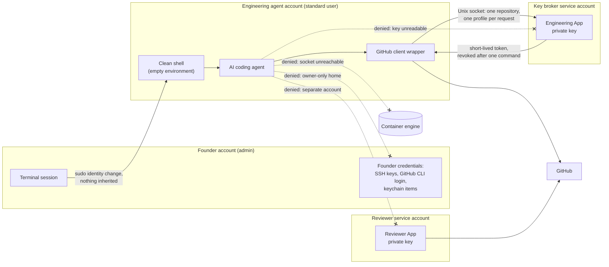

# Isolated engineering agent

Last verified: 2026-11-07

Status: **Implemented** since 2026-10-04, with headless entry added on 2026-10-27.

The AI coding agent does its work as a dedicated, non-admin macOS account.
That account cannot read the founder's credentials, has no GitHub identity of its own, cannot reach a container engine, and has exactly one controlled way to talk to GitHub.
This page explains why, how the boundary is established, and what the isolation test actually proves.

## Why the agent does not run as the founder

Before this existed, agent sessions ran as the founder's own macOS user.
An audit of that user, in October 2026, found what you would expect on a working engineer's machine: the founder's own GitHub credentials with broad scope, the independent reviewer's App key, and a long-lived token used by older automation.

Every one of those was readable by any process the founder ran, including an AI agent.
GitHub permissions cannot help here: a fine-grained token or a careful App permission set restricts what a credential can do, but it cannot stop a process from picking up a different, broader credential that its operating-system user can read.
The only boundary that works is a different operating-system user.

## What the account is

| Property | Why it matters |
| --- | --- |
| Standard (non-admin) user, not in the administrator, wheel or staff groups | No path to root through group membership or default shared-group file permissions |
| Its own primary group and an owner-only home directory | Its files are not readable by other users, and other users' homes are not readable by it |
| Not allowed to run sudo, verified from the sudoers policy | No privilege escalation by design |
| No graphical login, ever | It runs headless; there is no desktop session to share a keychain, clipboard or window server with |
| Its own clones of each repository over HTTPS, without credentials in any remote URL | Nothing in a checkout can authenticate on its own |
| Its own Claude Code login | Provider authentication only, which grants nothing on GitHub |
| No container engine | Container engines run as root in practice, so access to one is root-equivalent |

Container-based development is a known gap.
The target design gives the agent a bounded job interface to a separate isolated execution worker, never a Docker socket; that worker is [planned](../roadmap.md), not built.

## A clean shell, headless

The founder enters the account from a terminal pane in their own session, and the entry point matters more than it looks.

The obvious command, a sudo login shell as the agent user, failed the isolation check in 11 places when it was first measured on 2026-10-27.
macOS's default sudo policy keeps the caller's `PATH` and SSH agent socket, and sudo adds variables of its own, including the caller's home directory.
The agent's environment therefore pointed back into the founder's home and at the founder's SSH agent.

The fix keeps the same sudo identity change, so macOS sees the same security session, and then starts the agent's shell with an empty environment.
Only a minimal `PATH`, the terminal type and plain locale values cross the boundary; the account's own login files build everything else.
Before any startup file runs, the launcher refuses unless it really is the agent account and owns its own terminal, so nothing inside the account can push keystrokes into the founder's terminal.

The launcher runs as the founder, so it is not itself the trust boundary.
Anything that can already run as the founder can change what it does.
The boundary is the operating-system identity change, and the launcher's job is to make sure nothing leaks across it.

## The account has no GitHub identity

The property the platform proves is deliberately negative:

> If GitHub App authentication is absent or broken, the agent has no other GitHub identity to fall back to.

There is no SSH key, no GitHub CLI login, no Git credential helper that returns anything, no token in the environment or in any startup or configuration file, and no GitHub item in the account's keychain.
The only way in is the broker-issued, one-repository token described on the [authorization page](github-authorization.md), and when that path fails the agent simply cannot reach GitHub.

That refusal is the point.
An agent that silently falls back to a broader credential when its scoped one fails is an agent whose real permission set is the broadest credential it can find.

## Trust boundaries

Each subgraph is a separate macOS account.
The only arrow out of the agent account toward GitHub authority goes through the broker's socket, and the broker decides who is asking from the kernel, not from anything the agent sends.

## What the isolation check proves

A shell check runs from inside the agent account and passes only when every probe passes.
It uses metadata and behavior probes only: it names files and variables, and it never prints a key, a token or a password.

It checks, in broad groups:

- **Account shape.** Group memberships, primary group, home ownership and mode.
- **Founder paths.** The locations of the founder's credentials and the reviewer's state cannot be read, listed or even stat'ed.
- **Other homes.** Every other account's home, including the CI runner accounts, cannot be read or traversed.
- **Indirect routes.** A symlink the agent creates still cannot read a protected key; pointing the GitHub CLI at the founder's configuration directory yields no login; the founder's SSH agent socket refuses the account.
- **Ambient credentials.** The current shell, a login shell and an interactive shell carry no GitHub token variables, askpass helpers, Git configuration overrides, token-shaped values or paths into another home, and neither does the launchd environment.
- **Stored credentials.** No credential files, no token-shaped values in startup or configuration files, no GitHub item in the keychain, and no small file in the home that starts with a private-key header.
- **Real network behavior.** For each checkout, a read and a dry-run push are made against GitHub, and the check reads Git's own HTTP trace to confirm no `Authorization` header was sent. A successful push always fails the check.
- **Container engines.** No engine answers, and no Docker host or context is configured.
- **Broker key.** The broker's key directory cannot be listed and the key cannot be opened.
- **Tools.** Every required tool resolves outside every other user's home, so a tool cannot be swapped by another account.

Two rules make the result trustworthy rather than optimistic.
A probe that cannot be decided, for example because GitHub is unreachable, is `UNVERIFIED`, and `UNVERIFIED` fails the run.
The command overrides that exist for testing make any run that uses them `UNVERIFIED` too, so a test hook cannot produce a passing production result.

### How the check itself is tested

The test suite plants every failure mode in a throwaway home directory and requires the check to fail for each one.
Fakes stand in for `ssh`, `ssh-add`, `gh`, the keychain tool and remote Git operations, and system Git configuration is disabled, so the tests never reach the network or a real credential.
For the network probes, the tests also run real `git` against a loopback server that answers like GitHub's smart HTTP endpoint, so the trace the check judges is Git's own output, not a fake's.

### A false failure worth keeping

On 2026-10-27 the check started failing for a public repository checkout.
Its read probe had treated any successful `git ls-remote` as proof that some credential had authenticated, which is true for a private repository and false for a public one: GitHub answers public reads anonymously.
The fix judged each probe by the HTTP trace (did an `Authorization` header go out) and added a dry-run push, which GitHub always authenticates, so the check now proves the absence of a credential for public and private repositories alike.
The lesson is recorded on the [lessons page](../lessons/README.md#a-public-repository-answered-anonymously).

## What the check does not prove

- A non-admin macOS user is a useful boundary, not a virtual machine. A local privilege-escalation vulnerability in macOS would cross it.
- The check covers the credential locations it knows about. A founder credential stored somewhere new is not covered until the check learns about it.
- The founder's own account still holds the founder's credentials, by design. Retiring the last credential used by older automation is separate, open work.
- The live proof is run by the founder after changes and recorded on the change's ticket. It is not a continuous monitor.

## Related

- [GitHub authorization and the key broker](github-authorization.md)
- [Decision 2: brokered, short-lived credentials](../decisions/02-brokered-short-lived-credentials.md)
