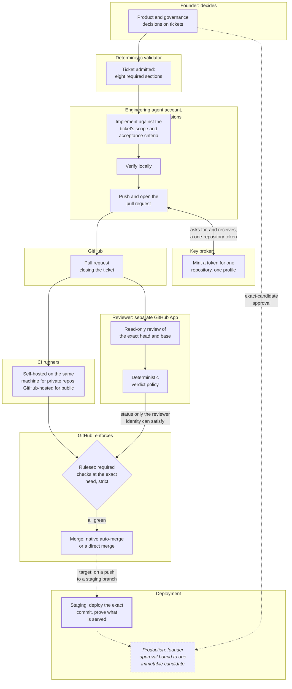

# Operating model

Last verified: 2026-11-08

This page is the big picture: how a piece of engineering work moves from a decision to a merged and deployed change, and which identity holds authority at each step.
The pages under [`architecture/`](architecture/) and [`workflows/`](workflows/) go deep on each part.

## The problem it solves

An AI coding agent can write and change code quickly.
The harder question is what authority it holds while it does.

When an agent runs as the developer's own operating-system user, it can read every credential that user can read: SSH keys, the GitHub CLI's login, organization-admin tokens, other services' keys.
No GitHub permission setting can tell an agent apart from the user whose credential it presents.
An agent that reviews its own change is also not an independent review, however careful it is, because the same context that produced a mistake is the context checking for it.
And a control that exists only as a habit, such as "I always look before I merge", stops existing the first time merging is automated.

So the design question became how to let the agent do as much engineering as possible while every piece of authority it needs is narrow, short-lived, enforced by something other than its own good behavior, and checked by something it cannot influence.

## Design philosophy

**Automate the repeatable work.**
Implementation, opening pull requests, running checks, reviewing and merging are mechanical once their inputs are decided.
The agent implements and opens pull requests within sessions the founder starts; checks, review and the merge decision then need no human, except in one repository where a recorded founder exception requires an approving review.
Staging deployment is designed to join that list, and is not in service yet.

**Keep authority boundaries explicit.**
Each identity has a written list of what it may do and what it may never do, and the list is enforced by the operating system, GitHub, or a credential broker.
When something is unavailable, the system refuses; it never falls back to a broader credential.

**Make human intervention meaningful.**
The founder decides what work exists, which repositories and permissions an identity may have, when a privileged component is installed, and (once built) which exact build reaches production.
The founder no longer approves individual pull requests.
That was a deliberate decision with real costs, explained in [decision 4](decisions/04-auto-merge-without-human-approval.md).

## End-to-end flow

Solid boxes and arrows run today; the thick border marks staging, which is built and tested but not in service; the dashed, italic box is planned; dotted arrows lead to work that does not run yet.

## Who holds authority at each step

| Step | Acts as | May | May never | Status |
| --- | --- | --- | --- | --- |
| Decide the work | Founder | Write tickets, record decisions, change governance | Be bypassed by an agent's own judgment about scope | Implemented |
| Admit the ticket | Deterministic validator, recomputed by every verifier | Accept a ticket whose current body has the eight required sections | Trust a label, which anyone with issue write access can apply | Implemented |
| Implement | Engineering agent account | Edit code, run local tools, ask the broker for a token | Read founder credentials, reach a container engine, hold a GitHub login | Implemented |
| Talk to GitHub | Engineering GitHub App, through the broker | Contents, pull requests and issues for one repository per token | Workflows, Actions, administration, deployments, secrets, organization settings | Implemented |
| Validate | CI on runners chosen by repository trust | Run checks on the pull request | Run public pull-request code on a private self-hosted runner | Implemented |
| Review | Reviewer service under its own App and macOS account | Read the exact change, publish a status and a comment | Execute pull-request code, approve, merge, or be produced by the engineering identity | Implemented |
| Merge | GitHub, through the repository ruleset | Merge when every required context is green at the exact head and the branch is current, on the platform, product-class and public repositories | Accept a status from any identity other than the one pinned for that context | Implemented |
| Deploy staging | Shared staging adapter with a staging-only credential in a branch-restricted environment; the credential model is designed, and no such credential is provisioned yet | Deploy one product's staging project | Reach production, which the provider refuses for a project-scoped token; that refusal is to be demonstrated before first use | Built, not in service |
| Promote to production | Product and environment specific deployment identity | Promote one approved, immutable candidate | Be reached from the agent account or an untrusted build | Planned |

## Where a human still intervenes

These are the places the founder acts, and each one is a decision rather than a rubber stamp:

- deciding what is worth building, and writing that down as a ticket an agent can be held to;
- authorizing a new repository, permission or identity, which takes effect only through a privileged installation the founder performs;
- ordering a fresh review when a reviewer defect or an outage made an earlier verdict wrong, which is bounded and recorded;
- approving one exact production candidate, once production promotion exists.

What the founder no longer does is look at every pull request before it merges.
The reviewer, the required checks and the ticket scope are the gate, and the [evidence page](evidence/README.md) shows how good that gate is and where it falls short.

## What is deliberately not automated

- Changes to the controls themselves are founder actions: the founder changes rulesets and App permissions directly, and changes to the installed controls (the broker's policy, the reviewer's installation) are proposed by pull request like any other change but take effect only through a privileged installation the founder performs.
- No identity the agent can reach holds production credentials, and products under the platform standard do not deploy to production on merge; one older product deploys from its default branch under a recorded founder exception.
- The reviewer never executes pull-request code. It reads and reasons, which is a real limitation as well as a security property, discussed on the [reviewer page](architecture/independent-reviewer.md#limitations).

## Where to go next

- [Isolated engineering agent](architecture/isolated-agent.md)
- [GitHub authorization and the key broker](architecture/github-authorization.md)
- [Independent local AI reviewer](architecture/independent-reviewer.md)
- [Delivery lifecycle and governance](workflows/delivery-lifecycle.md)
