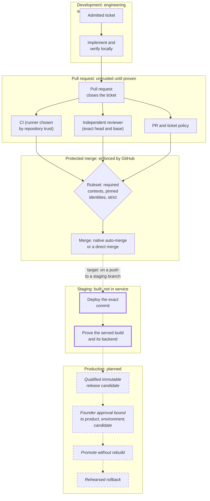

# Delivery lifecycle and governance

Last verified: 2026-11-08

This page follows a change from ticket to production and describes the shared governance that several independently developed products sit on.
Each section carries its own status, because this is the part of the platform where implemented and planned work sit closest together.

## The lifecycle

Solid boxes and arrows run today; the thick border marks staging, which is built and tested but not in service; dashed, italic boxes are planned; dotted arrows lead to work that does not run yet.

| Stage | Status |
| --- | --- |
| Ticket admission, pull-request policy, required checks, independent review, exact-head protected merge | Implemented |
| Automated merging when every required check passes | Implemented: native auto-merge is enabled on the platform repository and, by decision, on some others; direct merges by the engineering App or the founder pass the same ruleset |
| Staging deployment of the exact commit with a served-identity check | Built, not in service: the adapter is built and tested, and no product deploys through it |
| Release candidates, founder-bound production approval, promotion without rebuild, rehearsed rollback | Planned |

## Ticket-driven work

Every engineering ticket must contain eight sections: Problem, Desired Outcome, Scope, Out of Scope, Acceptance Criteria (with at least one list item), Verification, Dependencies and Blockers, and Risks and Constraints.
A small, dependency-free validator checks this, and its parser is shared with the reviewer through a common set of test vectors, so both read a ticket the same way.

The important design choice is that **admission is recomputed, not recorded**.
A workflow labels tickets `ticket:ready` or `ticket:invalid` for people to see, but nothing that decides whether work may proceed reads that label, because anyone with issue write access can apply it.
Every verifier, including the pull-request policy and the reviewer, re-runs the validator on the ticket's current body at the moment it decides.
An admission receipt published by a trusted App was considered and rejected: its issuer would make the same deterministic decision every verifier can recompute, so it would add a write path, a permission and mutable state without adding a security property.

Admission is also separate from authorization.
A well-formed ticket is admitted; whether anyone decided the work should happen is a separate, human question.

Where the reviewer enforces ticket scope, a pull request must close at least one open, admitted ticket in the same repository, and the reviewer judges the diff against that ticket's Scope, Out of Scope and Acceptance Criteria.
The reviewer is instructed to grade scope findings by consequence rather than file count: unauthorized expansion across a security or data boundary is P1, material unrelated behavioral work is P2, and lower-risk unnecessary expansion is P3.
That grading is model judgment, not a deterministic rule.
Editing the ticket's scope sections (Problem, Desired Outcome, Scope, Out of Scope, Acceptance Criteria, Verification) after a pass revokes the pass on the unchanged head.

## Required checks, exact commits

On the platform repository, the product-class repositories and the public repositories, the default branch has a ruleset with no bypass actors that refuses deletion and force-pushes, requires a pull request, and requires a small set of status checks with strict freshness.
Three other governed repositories are not yet uniform with this, each in a specific, recorded way; bringing them in line is open work.
Each required check is pinned to the integration that is allowed to produce it, so the reviewer's context can only be satisfied by the reviewer App and CI contexts only by GitHub Actions.

Strict freshness means a pull request can merge only while its head is up to date with the protected branch.
Together with head-anchored statuses, this gives exact-commit verification: what merges is the commit that was reviewed and tested, against the base it was reviewed against.
An illustrative ruleset is in [`examples/github/ruleset-protected-main.json`](../../examples/github/ruleset-protected-main.json).

## Automated merging

Pull requests merge once every required check is green at the exact head, either through GitHub's native auto-merge or by a direct merge from the engineering App or the founder; neither path can bypass the ruleset.
There is no merge bot, merge service, approval service or scheduler.
The engineering App can arm auto-merge or merge directly, but it can never publish the reviewer's context, so it cannot merge anything the reviewer has not passed where the reviewer is required.

Getting here took an audit and a reversal, described in [decision 4](../decisions/04-auto-merge-without-human-approval.md).
The short version is that founder-only paths were once protected only by the founder's habit of merging by hand, a GitHub-native required-reviewer rule was built to make that real, and then the founder deliberately removed human approval for every path in the platform repository, keeping the pinned reviewer and CI as the gate.

## Shared governance components

Several products are developed independently, at different speeds, and none of them should break because another changed something central.
The platform therefore releases its governance as versioned components:

| Component | What it enforces |
| --- | --- |
| Ticket and pull-request policy | The eight-section ticket contract, the pull-request contract, and that a pull request closes an open, admitted ticket |
| Runner policy | Every CI job runs on exactly one approved runner class, chosen by an exact selector, with governance jobs bounded to ten minutes in the current release; repositories still pinned to an older release run their policy jobs on the application class and without that bound until they move their pin |
| Product repository standard | A product repository declares and provides the documents and governance roles the standard requires |

Each release is a tag that, by policy, is never moved; a correction is a new version, never a re-tag.
No ruleset enforces that policy, so the guarantee comes from the consumers: governed private repositories pin a full 40-character commit SHA, with the tag in a comment for humans, so a moved tag could not change what they run without a reviewed pull request that re-pins them.
Public repositories do not consume these components; they follow the separate model described [below](#public-and-private-repositories).
A branch reference is never used, because a branch means a central edit reaches every repository the moment it merges, with nobody choosing it.

The runner policy parses what it judges rather than pattern-matching text.
It parses every workflow with a YAML parser and judges each job from the parsed tree, and an expression anywhere in a runner selector is refused, because an expression could resolve to a different runner at run time.
The product standard uses a deliberately restricted manifest parser with no YAML dependency, so local and CI verdicts are identical.
Its check of a repository's governance workflow references is simpler: a line match that confirms each reference is pinned to a full commit SHA, not that the SHA is the released one.

### Verification across repositories

An onboarding operation reads the organization's intended state from one declarative inventory: runner classes and their members, the released version of each component, the governance workflows and the contexts they produce, repository classes with their rulesets, and each repository's class.
It can onboard one repository, verify one, or audit the whole organization against live GitHub in both directions, reporting anything present but not declared and anything declared but not present.
Verify and audit fail a repository whose default branch does not carry the released governance versions.
It is idempotent: a conforming repository produces zero changes, and two runs against the same live state compute the same plan.
It fails closed, reporting a blocked step with the permission it needed rather than skipping it.
It adds a repository to the private runner group only when the inventory declares it, or while it creates or adopts that repository as a governed one, and refuses any change that would widen the group's visibility or admit public repositories.

## CI runners and workload separation

Private governed repositories, the private repositories the onboarding inventory declares, run CI on self-hosted runners on the same machine, split into two classes that differ by one label:

| | Compute class | Governance class |
| --- | --- | --- |
| For | Application builds, databases, integration tests | Short policy checks |
| Container engine | One isolated VM per runner, with only that runner's ports forwarded | None at all |
| Job length | The repository's own timeouts | 1 to 10 minutes, required by the runner policy |

The split came from a measured incident.
On 2026-09-30, as recorded at the time, three long application jobs held the only runner for 102 minutes while 20-second policy checks waited, one of them for 68 minutes.
The jobs' own queue and start times for that day show longer waits still: 15 policy checks waited more than an hour, the longest 115 minutes.
A second identical runner would not have fixed it, because GitHub hands a job to any runner carrying every requested label, so two long jobs could still occupy both.
Making the classes disjoint turns the separation into a property of GitHub's scheduler.

The persistent self-hosted runners are not a clean security boundary for code a repository supplies, which is acceptable only because they serve private repositories under the same owner.
Disposable, one-job execution for untrusted code is [planned](../roadmap.md).

## Public and private repositories

A public repository is a different trust problem: anyone can fork it and open a pull request.
Public repositories therefore form a separate, audited category:

- CI runs only on GitHub-hosted runners, which are ephemeral and isolated per job;
- the private runner group refuses public repositories, and the onboarding operation refuses to widen it;
- the organization audit checks that each public repository is actually public, is not admitted to the runner group, has no workflow job that names a self-hosted selector or chooses its runner in a way that cannot be resolved statically, and requires the reviewer's context pinned to the reviewer App with strict freshness;
- the default workflow token is read-only and workflows cannot approve pull requests;
- the self-hosted governance workflows cannot run there, so the reviewer enforces ticket scope instead.

The reasoning is in [decision 5](../decisions/05-public-and-private-ci-security-models.md).
This repository is the second member of that category, after CreatorBrio.

## Staging

Status: **Built, not in service.**

The target behavior: on every push to a product's staging branch, deploy exactly that commit to the product's staging project, wait a bounded time for the hosting provider to serve it, prove that the served build is that commit, and prove it talks to the staging backend and not to a legacy or production one.

What is built:

- **A shared staging adapter, built and tested against a fake hosting API and a fake served site.** It refuses anything but a full 40-character commit, creates the deployment exactly once and never retries the create request (a failed create is reported as "outcome unknown" because it may have created a deployment), treats the deployment as served only when it is ready and its aliases have moved, and scans the served HTML and scripts for expected and forbidden backend identities, failing closed at every size and time bound.

What is designed, not provisioned:

- **A staging-only credential model.** The hosting provider's project-scoped token is refused for every other project, including production, and is to live only in a GitHub environment restricted to the staging branch, never in a repository secret or an agent environment; no such token or environment exists yet, and the refusal against production is to be demonstrated before first use.

What ran, and has stopped:

- **A served-identity check in the first product's own CI** checked, on pushes to staging, that the served page's identity matched the pushed commit, and ran until that product's CI runner was retired on 2026-10-30; it cannot run again until the product is onboarded onto the platform's runners.

What does not exist yet: the reusable workflow that lets products call the shared adapter has not been released, so no product deploys through the adapter.
Several provider behaviors the adapter depends on are recorded as unverified until its first live run.

## Production promotion and rollback

Status: **Planned.** None of this section is implemented.

The design, adopted as a target on 2026-10-11:

- **A qualified, immutable release candidate.** The thing promoted to production is the thing that was qualified. A staging build may differ when build-time configuration differs, but the production candidate itself is never rebuilt between qualification and promotion.
- **Founder approval bound to one candidate.** Approval names the product, environment, commit, deployment and migration set, is received by a control plane the engineering identity cannot forge, and unlocks a production credential only after it is given.
- **Separate deployment identities** per product and environment, unreachable from the agent account or an untrusted build.
- **No deployment on merge.** Mapping existing products onto this design showed why this must be a precondition rather than a default: a hosting provider's Git integration can deploy production whenever the default branch moves, and the product runbook's interim control is to stop production builds until the standard exists.
- **Code rollback first, data recovery separately.** Rolling back to a previous release is the first response to bad code. Restoring data is a different, higher-risk operation with its own approval, and every product needs a rehearsed restore with measured recovery point and recovery time before its first production deployment under this model.

The production security standard that makes these enforceable is an open piece of work.

## What the automation removed

Before this platform, moving a change to merge meant a person checking that the work had a well-formed ticket, that the branch was current, that CI was green, that someone had looked at the diff, and then clicking merge, for every pull request in every repository.
Each of those is now a check that GitHub enforces at the exact head, though a ticket check confirms structure, not whether the work is wise, so the founder's time goes to the decisions on the [operating model](../operating-model.md#where-a-human-still-intervenes) page instead.

I have not measured how much time this saves, and this page does not estimate it.
